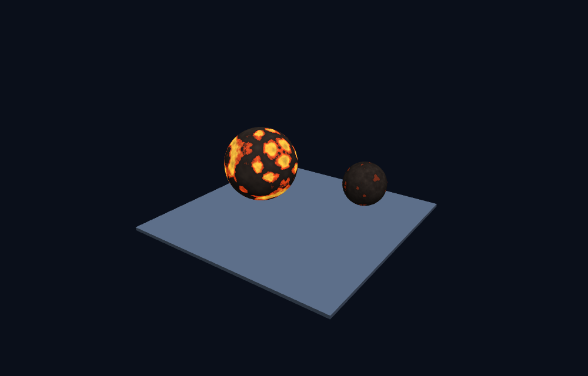
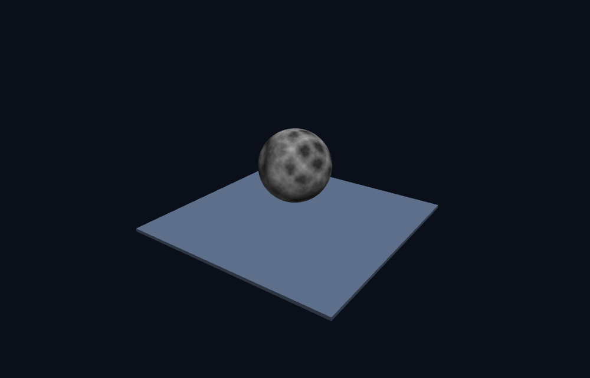
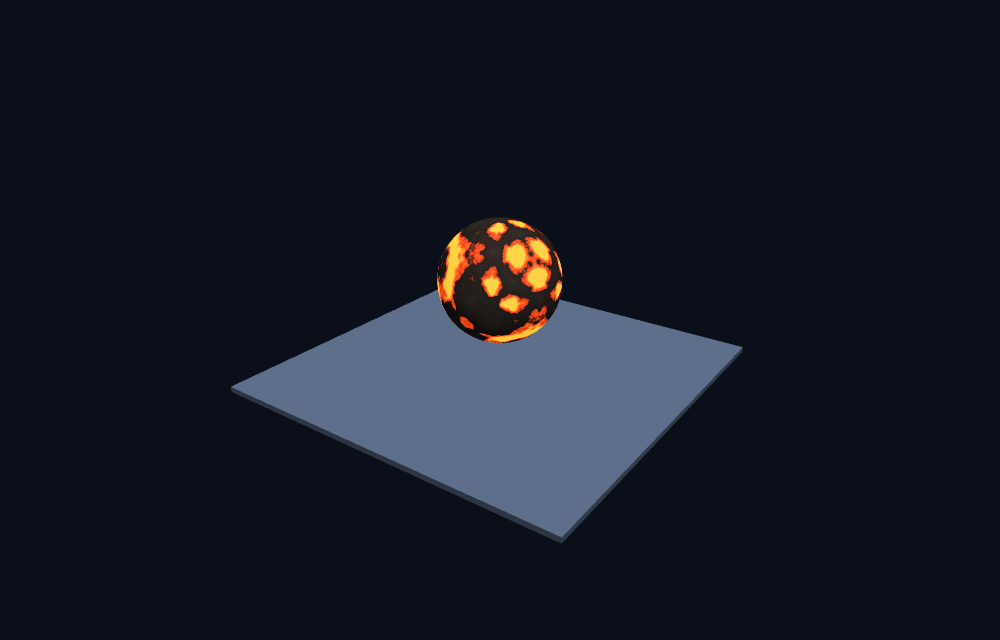
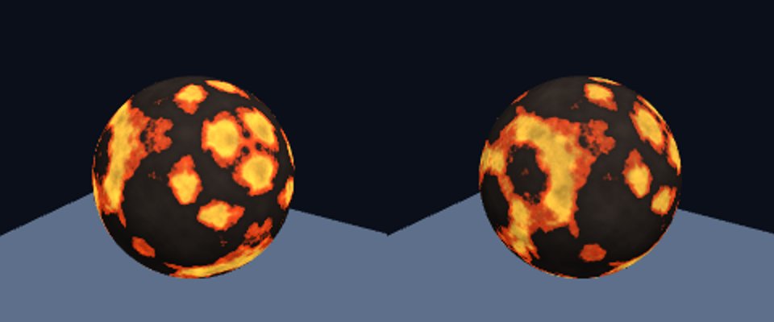

# 3주차 보고서

- 이름: 김병찬
- 저장소: https://github.com/giwonBC/cg-2026-solar


## Task 1 — 따라 하며 코드 구조 익히기

- 실행: [[Task 1](task1.html)](https://giwonbc.github.io/cg-2026-solar/week3/task1.html)

**확인 질문 — 꼭짓점은 3개인데 색이 부드럽게 이어지는 이유**
버텍스 셰이더는 꼭짓점에서만 실행된다. 그 사이의 값은 래스터화 단계가 자동으로 채운다. 
내가 계산한 적이 없는 값이기 때문에 안쪽에 그라데이션으로 색이 생긴다.

**구를 상자와 다르게 만드는 이유** - 상자는 면이 6개라 손으로 적을 수 있지만, 하지만 구는 곡면이기 때문에 위도·경도를 따라 격자점을 찍고 이웃한 네 점을 삼각형 두 개로 잇는다. 

**바닥도 상자인가** - 높이만 낮은 납작한 상자가 맞다. 

### 직접 만든 `rotateZ`

종이 위의 Rz 를 열 우선으로 옮긴다. 

```js
M4.rotateZ = function (angle) {
  const c = Math.cos(angle);
  const s = Math.sin(angle);
  return new Float32Array([
     c, s, 0, 0,   // 1열
    -s, c, 0, 0,   // 2열
     0, 0, 1, 0,   // 3열
     0, 0, 0, 1,   // 4열
  ]);
};
```

### 5단계 — 카메라를 기본 변환만으로 만들기

카메라라는 물체는 없으므로, 카메라를 움직이는 대신 **세계를 반대로** 움직이기.

```js
let camera = M4.identity();
camera = M4.multiply(M4.translate(0, -1.1, 0), camera);  // ① 보고 싶은 지점을 원점으로
camera = M4.multiply(M4.rotateY(-0.62), camera);         // ② 세계를 좌우로 돌림
camera = M4.multiply(M4.rotateX(0.42), camera);          // ③ 세계를 기울임 → 위에서 내려다봄
camera = M4.multiply(M4.translate(0, 0, -8), camera);    // ④ 세계를 앞으로 밀어냄
camera = M4.multiply(perspective, camera);               // ⑤ 원근 (w = 1 - z/8)
camera = M4.multiply(M4.scale(1 / (3.4 * aspect), 1 / 3.4, -1 / 30), camera); // ⑥ -1~1 로 축소
```

**숫자를 바꿔 본 결과**

| 바꾼 곳 | 바꾼 값 | 관찰 |
| --- | --- | --- |
| ② `rotateY(-0.62)` | `time * 0.3` | 카메라가 장면 둘레를 천천히 돈다 |
| ③ `rotateX(0.42)` | `0` | 눈높이 시점이 되어 바닥이 얇은 선처럼 보인다 |
| ④ `translate(0,0,-8)` | 더 큰 값 | 장면이 멀어져 작아진다 |
| ⑤ `-1 / 8` | `-1 / 30` | 원근이 거의 사라진다 |
| ⑥ `1 / 3.4` | 더 작은 값 / 큰 값 | 축소 / 확대 |

**`-1/30` 으로 하면 원근이 사라지는 이유** — 장면은 카메라 앞 대략 z = -3 ~ -13 사이에 있다. `-1/8` 이면 원근은 점의 좌표를 w = 1 + 거리/8로 나눠서 생긴다. `w` 가 약 1.4 ~ 2.6 으로 두 배 가까이 차이 나서, 가까운 곳과 먼 곳의 크기가 크게 다르다. `-1/30` 이면 `w` 가 약 1.1 ~ 1.4 로 거의 같아서, 큰 수로 나눌수록 모든 점의 w가 1에 가까워져 원근이 사라지고 직교 투영에 가까워진다.


### 6단계 — 변환 순서 비교

**(가) 회전 → 이동 : 제자리에서 자전**

```js
const model = M4.multiply(M4.translate(2, 1.9, 0), M4.rotateY(time * 0.8));
```


**(나) 이동 → 회전 : 원을 그리며 공전**

```js
const model = M4.multiply(M4.rotateY(time * 0.8), M4.translate(2, 1.9, 0));
```


**설명** — 행렬은 **오른쪽부터** 적용된다.

- (가)는 원점에 있는 공을 먼저 y축 기준으로 돌리고, 그다음 `(2, 1.9, 0)` 으로 옮긴다. 회전할 때 공의 중심이 회전축 위에 있으므로 공은 제자리에서 돌기만 하고, 그 상태로 옮겨진다.
- (나)는 공을 먼저 `(2, 1.9, 0)` 으로 옮기고, 그다음 **세계의** y축을 기준으로 돌린다. 이때 공의 중심은 축에서 2 만큼 떨어져 있으므로, 반지름 2 인 원을 그리며 공전한다.


### 8단계 — 셰이더 바꿔 보기: 법선을 색으로

```glsl
void main() {
  vec3 N = normalize(vNormal);
  fragColor = vec4(N * 0.5 + 0.5, 1.0);   // -1~1 인 법선을 0~1 색으로
}
```


**관찰** — 법선의 x, y, z 가 각각 빨강, 초록, 파랑이 된다. 구는 정점마다 법선 방향이 조금씩 달라서 표면이 무지개처럼 부드럽게 물든다. 바닥은 한 면의 꼭짓점 4개가 모두 같은 법선을 가지므로 면 하나가 한 색이 된다. 윗면은 연두색으로 보인다.


## Task 2 — 살아 있는 행성 만들기

- 실행: https://giwonbc.github.io/cg-2026-solar/week3/task2.html



### ① 의도 — 무엇을 만들고 싶었는가

**한 문장:** 갈라진 검은 바위 틈에서 용암이 끓는 젊은 행성과, 같은 행성이 늙어 용암이 거의 식어 버린 모습을 나란히 보여 주고 싶었음.

- **왜 용암 행성인가** — 행성은 만들어지자마자 표면이 뜨겁다. 이제 막 만들어져서 뜨거워보이는 용암 행성을 표현하고 싶었음. 
- **왜 두 행성이 같은 셰이더인가** — 서로 상관없는 행성 두 개보다, 같은 행성의 젊을 때와 늙었을 때를 비교하는 편이 좋다고 생각함. 셰이더 하나에 `uAge`(나이) 값 하나만 바꿔서 두 모습을 만들었음.
- **예시와 다른 점** — 예시의 가스 행성은 `sin(위도)` 로 가로 띠를, 바위 행성은 대륙과 구름을 만들었습니다. 잡음을 높이로 읽고, 낮은 곳을 바위가 아니라 용암으로 채웠음. 숫자 하나로 행성의 나이를 조절한 점도 다름.

### ② 방법 — 어떻게 만들었는가

실습 1 의 장면(바닥·카메라·행렬)은 그대로 둠.

| 바꾼 곳 | 내용 |
| --- | --- |
| 구 | `makeSphere(1.3, 64, 128, 1.0, 1.0, 1.0)` — 분할 수를 올리고 색은 셰이더에 맡김 |
| 버텍스 셰이더 | `vSurf = aNormal` — 돌리기 전 법선을 따로 넘겨 무늬가 표면에 붙어 돌게 함 |
| `uIsPlanet` | 바닥과 행성이 같은 셰이더를 쓰므로, 행성일 때만 무늬를 그리도록 구분 |
| `uAge` | 행성의 나이. 젊은 행성 0, 늙은 행성 1 로 같은 메시를 두 번 그림 |

#### 요소 1 — 지형 높이와 용암 웅덩이

```glsl
float height = fbm(S * 3.0 + vec3(uAge * 7.0));
float level  = mix(0.42, 0.33, uAge);
float lava   = 1.0 - smoothstep(level, level + 0.05, height);
color += lava * lavaColor;
```

- 물체 기준 법선 `S` 는 구 위의 위치이므로, 그 자리의 `fbm` 값을 땅의 높이로 씀. 5겹 잡음이라 큰 분지와 잔 굴곡이 함께 생김.
- `smoothstep(level, level+0.05, h)` 는 높이가 `level` 아래면 0, 위면 1 이다. 이를 `1.0 -` 로 뒤집어 낮은 곳만 1(용암)이 되게 함. 0.05 의 폭 덕분에 용암 가장자리가 부드럽게 번짐.
- 바위는 `diff`(햇빛)를 곱해 밤쪽이 어두워지지만, 용암은 곱하지 않고 더하기만 해서 밤쪽에서도 빛납니다. 낮과 밤의 경계가 보이면서도 용암은 스스로 빛나는 표면이 됨.

#### 요소 2 — 흐르는 용암

```glsl
float speed = mix(1.0, 0.2, uAge);
float flow  = fbm(S * 9.0 + vec3(0.0, uTime * 0.25, uTime * 0.15) * speed);
lavaColor  *= 0.6 + 0.8 * flow;
lavaColor  *= 0.85 + 0.15 * sin(uTime * 1.5);
```

- 지형보다 세 배 잘게(`* 9.0`) 만든 잡음을 용암 안쪽의 결로 씀.
- 잡음을 읽는 위치에 `uTime` 을 더해 조금씩 옮기면, 같은 무늬가 미끄러지며 흘러가는 것처럼 보임. 웅덩이 모양에는 시간을 넣지 않아서 웅덩이는 제자리에 있고 그 안의 결만 흐름.
- `sin(uTime * 1.5)` 로 밝기를 0.7 ~ 1.0 배 사이에서 약 4초 주기로 오르내리게 해, 행성 전체가 밝아졌다 어두워졌다를 반복함.

#### 요소 3 — 나이 `uAge` 하나로 두 행성

| 줄 | 젊음(0) → 늙음(1) | 의미 |
| --- | --- | --- |
| `level = mix(0.42, 0.33, uAge)` | 용암 기준 높이 낮아짐 | 가장 깊은 틈에만 용암이 남는다 |
| `deep *= 1.0 - uAge` | 노란 중심이 사라짐 | 가장 뜨거운 부분이 없어진다 |
| `speed = mix(1.0, 0.2, uAge)` | 흐름이 느려짐 | 식어서 굳어 간다 |
| `lavaColor *= mix(1.0, 0.45, uAge)` | 어두워짐 | 전체가 식는다 |

`mix(젊을 때, 늙었을 때, uAge)` 꼴로 썼기 때문에 `uAge` 를 0.5 로 두면 중간 나이의 행성도 바로 만들 수 있음. 늙은 행성은 모델 행렬에 `scale(0.6)` 을 넣어 작게 했고, 순서는 오른쪽부터 줄이고 → 자전 → 제자리로 이동 이다.

### 만들어 간 과정

| 단계 | 화면 | 한 일 |
| --- | --- | --- |
| 1 |  | 잡음을 높이로 읽어 **흑백**으로만 먼저 확인 |
| 2 |  | `smoothstep` 으로 낮은 곳에 용암, 바위는 빛을 받고 용암은 더하기 |
| 3 |  | `uTime` 으로 용암 안쪽 결이 흐르게 (2초 간격 두 장면) |
| 4 |  | `uAge` 로 같은 셰이더에서 늙은 행성 하나 더 |

### 부딪힌 문제와 고친 방법

- **바닥까지 용암 무늬가 생길 문제** — 바닥과 행성이 같은 프래그먼트 셰이더를 쓰기 때문에, 행성용 무늬를 넣으면 바닥에도 그려짐. `uIsPlanet` uniform 을 만들어 바닥을 그릴 때는 0, 행성을 그릴 때는 1 을 넣고, 0 이면 실습 1 의 조명만 하고 `return` 하도록 고침.
- **두 행성이 쌍둥이로 보이는 문제** — 같은 잡음 함수에 같은 좌표를 넣으면 두 행성의 웅덩이 위치가 똑같아집니다. 잡음을 읽는 위치를 `vec3(uAge * 7.0)` 만큼 옮겨 다른 지형이 나오게 함.

### 프래그먼트 셰이더 전체

```glsl
#version 300 es
precision highp float;

in vec3 vColor;
in vec3 vNormal;
in vec3 vSurf;                        // [실습2] 물체 기준 법선

uniform float uTime;
uniform float uIsPlanet;              // [실습2] 1 이면 행성, 0 이면 바닥
uniform float uAge;                   // [4단계] 행성의 나이 — 0 = 젊음, 1 = 늙음

out vec4 fragColor;

// ── 잡음 ① hash31 — 3차원 좌표 → 0~1 가짜 난수 (같은 좌표면 항상 같은 값)
float hash31(vec3 p) {
  p = fract(p * 0.3183099 + 0.1);
  p *= 17.0;
  return fract(p.x * p.y * p.z * (p.x + p.y + p.z));
}

// ── 잡음 ② noise3 — 격자 꼭짓점 8개의 난수를 부드럽게 섞는다
float noise3(vec3 x) {
  vec3 i = floor(x);                  // 내가 들어 있는 격자 칸의 모서리
  vec3 f = fract(x);                  // 칸 안에서의 위치 (0~1)
  f = f * f * (3.0 - 2.0 * f);        // smoothstep 곡선 — 경계를 매끄럽게

  float a = hash31(i + vec3(0, 0, 0));
  float b = hash31(i + vec3(1, 0, 0));
  float c = hash31(i + vec3(0, 1, 0));
  float d = hash31(i + vec3(1, 1, 0));
  float e = hash31(i + vec3(0, 0, 1));
  float g = hash31(i + vec3(1, 0, 1));
  float h = hash31(i + vec3(0, 1, 1));
  float k = hash31(i + vec3(1, 1, 1));

  return mix(mix(mix(a, b, f.x), mix(c, d, f.x), f.y),
             mix(mix(e, g, f.x), mix(h, k, f.x), f.y), f.z);
}

// ── 잡음 ③ fbm — 크기·세기를 절반씩 줄여 가며 5겹 더한다
float fbm(vec3 p) {
  float sum = 0.0;
  float amp = 0.5;
  for (int n = 0; n < 5; n++) {
    sum += amp * noise3(p);
    p   *= 2.0;                       // 다음 겹은 무늬가 두 배 촘촘
    amp *= 0.5;                       // 대신 세기는 절반
  }
  return sum;
}

void main() {
  vec3 N = normalize(vNormal);                    // 세계 기준 법선 — 빛
  vec3 L = normalize(vec3(0.45, 0.8, 0.35));
  float diff = max(dot(N, L), 0.0);

  // 바닥은 실습 1 그대로
  if (uIsPlanet < 0.5) {
    fragColor = vec4(vColor * (0.3 + 0.7 * diff), 1.0);
    return;
  }

  // ── 행성 ───────────────────────────────────────────────
  vec3 S = normalize(vSurf);                      // 물체 기준 법선 — 무늬

  // [1단계] 잡음을 "높이"로 읽는다 (0~1, 밝을수록 높은 땅)
  //   [4단계] 나이마다 지형을 옮겨 두 행성이 쌍둥이처럼 보이지 않게 한다
  float height = fbm(S * 3.0 + vec3(uAge * 7.0));

  // [2단계] 바위 — 높을수록 밝은 회갈색, 낮을수록 검은 현무암
  vec3 rock = mix(vec3(0.05, 0.04, 0.04), vec3(0.32, 0.27, 0.24), height);

  // [2단계] 용암 — 높이가 0.42 보다 낮은 곳만 1, 0.47 보다 높으면 0
  //   [4단계] 늙을수록 기준이 낮아져 가장 깊은 틈에만 용암이 남는다
  float level = mix(0.42, 0.33, uAge);
  float lava = 1.0 - smoothstep(level, level + 0.05, height);

  // [2단계] 용암 색 — 가장자리는 진한 주황, 깊은 곳일수록 노랗게
  float deep = 1.0 - smoothstep(0.30, 0.42, height);
  deep *= 1.0 - uAge;                             // [4단계] 늙은 행성은 노란 부분이 없다
  vec3 lavaColor = mix(vec3(0.85, 0.18, 0.02), vec3(1.0, 0.75, 0.20), deep);

  // [3단계] 용암 표면이 흐른다 — 잘게 만든 잡음을 시간에 따라 밀어낸다
  float speed = mix(1.0, 0.2, uAge);               // [4단계] 늙을수록 느리게 흐른다
  float flow = fbm(S * 9.0 + vec3(0.0, uTime * 0.25, uTime * 0.15) * speed);
  lavaColor *= 0.6 + 0.8 * flow;                  // 흐르는 무늬만큼 밝기가 오르내린다

  // [3단계] 숨 쉬듯 천천히 밝아졌다 어두워진다
  lavaColor *= 0.85 + 0.15 * sin(uTime * 1.5);

  // [4단계] 늙을수록 식어서 어둡다
  lavaColor *= mix(1.0, 0.45, uAge);

  // 바위는 햇빛을 받아야 보이고, 용암은 스스로 빛나므로 빛과 상관없이 더한다
  vec3 color = rock * (0.3 + 0.7 * diff);
  color += lava * lavaColor;

  fragColor = vec4(color, 1.0);
}

```
