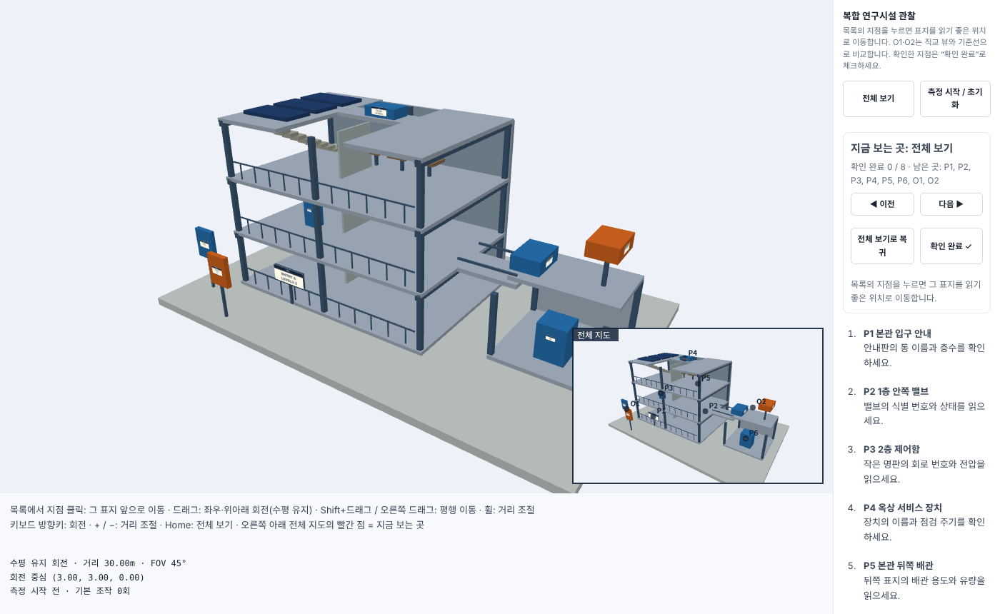
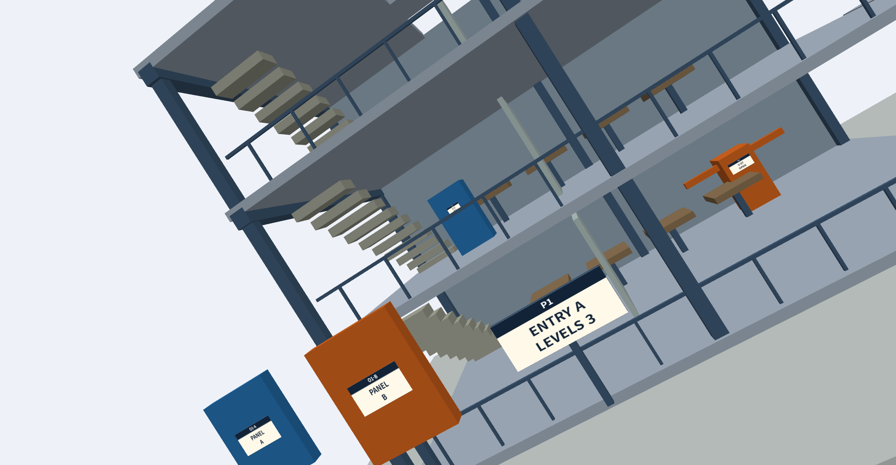
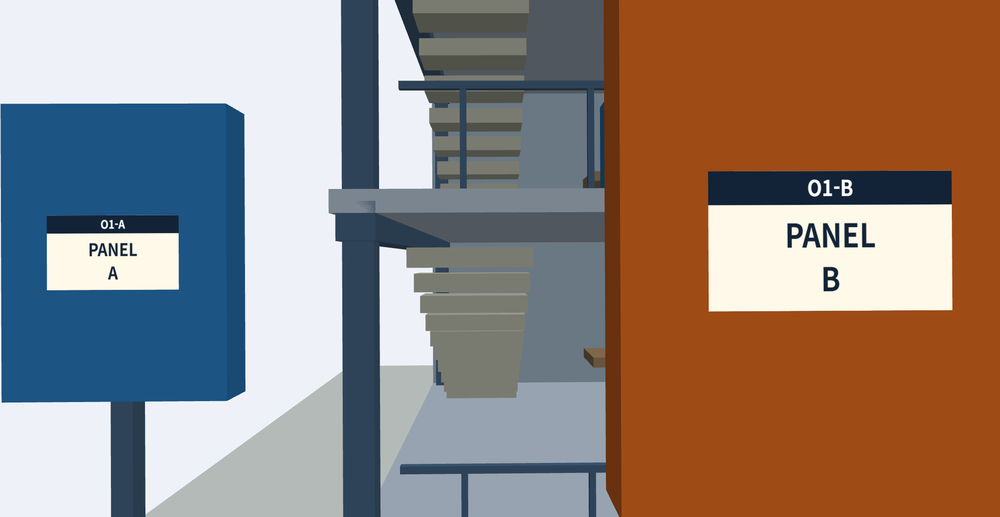

# 4주차 — 중요한 정보를 놓치지 않는 3D 관찰 인터페이스

- 이름: 김병찬
- 저장소: https://github.com/giwonBC/cg-2026-solar/tree/main/week4
- 실행: [기본 버전](https://giwonbc.github.io/cg-2026-solar/week4/baseline/index.html) · [개선 버전](https://giwonbc.github.io/cg-2026-solar/week4/improved/index.html)

> ✏️ 표시가 있는 곳은 직접 확인해서 채우거나 고칠 부분입니다. 제출 전에 이 줄과 함께 지우세요.

## 1. 실행 주소와 조작법

| 버전 | 실행 주소 |
| --- | --- |
| 기본 버전 | https://giwonbc.github.io/cg-2026-solar/week4/baseline/ |
| 개선 버전 | https://giwonbc.github.io/cg-2026-solar/week4/improved/ |

**기본 버전** — 드래그: 트랙볼 회전 · Shift+드래그 / 오른쪽 드래그: 평행 이동 · 휠: 거리 조절 · 방향키: 회전 · Home: 전체 보기

**개선 버전**

| 조작 | 동작 |
| --- | --- |
| 오른쪽 목록에서 지점 클릭 (또는 ◀ 이전 / 다음 ▶) | 그 표지를 읽기 좋은 위치로 0.9초 동안 이동, 회전 중심이 그 표지로 바뀜 |
| 드래그 | 가로 = 좌우 회전, 세로 = 위아래 회전 (화면이 기울지 않음) |
| Shift+드래그 / 오른쪽 드래그 / 휠 | 평행 이동 / 거리 조절 (기본과 같음) |
| O1 · O2 클릭 | 전면 / 오른쪽 측면 **직교 뷰**로 전환, 비교할 모서리에 점선 기준선. 회전은 잠기고 드래그는 이동 |
| 확인 완료 ✓ | 지금 지점을 확인 목록에 체크. 남은 지점이 패널에 표시됨 |
| 전체 보기로 복귀 | 처음 시점으로 부드럽게 돌아감 |
| 오른쪽 아래 전체 지도 | 모든 지점 위치, 빨간 점 = 지금 보는 곳, 점선 = 카메라가 보는 방향 |

## 2. 기본 버전 관찰 결과

전체 보기에서 시작해 P1 → P6 → O1 → O2 순서로 관찰했습니다. 시간과 조작 횟수는 화면 아래 측정값을 지점마다 기록했습니다.

| 지점 | 결과 | 시간 | 조작 | 어려웠던 점 |
| --- | --- | --- | --- | --- |
| P1 본관 입구 안내 | 성공 | 5초 | 8회 | ✏️ |
| P2 1층 안쪽 밸브 | 성공 | 7초 | 20회 | 회전하다 화면이 기울어 다시 맞춤 |
| P3 2층 제어함 | 성공 | 7초 | 19회 | 회전 중 기울어짐, 확대 후 위치를 모름 |
| P4 옥상 서비스 장치 | 성공 | 10초 | 17회 | 회전하다 화면이 기울어 다시 맞춤 ✏️ |
| P5 본관 뒤쪽 배관 | 성공 | 9초 | 18회 | 회전하다 화면이 기울어 다시 맞춤 ✏️ |
| P6 별관 펌프 | 성공 | 7초 | 13회 | ✏️ |
| O1 전면 패널 정렬 | **판단 보류** | 6초 | 10회 | 원근 때문에 B 가 커 보여 크기가 같은지 알 수 없음 |
| O2 측면 돌출 비교 | ✏️ 판단 결과 | 4초 | 8회 | ✏️ |
| **합계** | 6 성공 · 보류 ✏️ | **55초** | **113회** | |

가장 큰 문제는 시간보다 **조작 횟수**였습니다. P2·P3 는 7초 동안 약 20번(1초에 3번 가까이) 조작했습니다. 원하는 곳을 찾기보다 화면을 원하는 각도로 맞추느라 짧은 드래그를 반복했습니다.

### 불편 1 — 화면이 원치 않게 기울어진다

회전이 왼쪽 드래그 하나로 자유롭게 돌아가는 트랙볼이라, 손을 조금만 비스듬히 움직여도 화면이 옆으로 기울었습니다. 건물이 대각선으로 누워 층의 위아래가 헷갈리고 글자도 비스듬해집니다. 다시 수평을 맞추느라 조작이 늘었습니다(P2 20회, P3 19회).

### 불편 2 — 원근 화면에서는 O1 크기를 비교할 수 없다

패널 A·B 는 같은 크기(1.2 × 1.6 m)이지만, B 가 카메라 쪽으로 1.6 m 더 나와 있어 화면에서는 B 가 훨씬 크게 보입니다. 원근 투영은 가까운 것을 크게 그리므로, 깊이가 다른 두 물체의 높이·폭을 눈으로 비교할 수 없어 **판단 보류**로 남겼습니다.

### 불편 3 — 작은 명판을 확대하면 지금 어디인지 알 수 없다

P3 명판(0.28 m)은 읽혔지만, 화면에 계단·칸막이·천장만 남아 이곳이 건물 몇 층 어디인지 알 수 없었습니다. 화면도 살짝 기울어 있습니다.

## 3. 누구를 위해 무엇을 개선할까

**사용자:** 3D 조작에 익숙하지 않은 점검자가 여섯 장치의 표지와 두 구조 비교를 **적은 조작으로 빠짐없이** 확인한다.

**목표 두 가지:** ① 조작 부담 줄이기 (반복 회전·확대 없애기) ② 위치 파악과 누락 방지

### 대안 비교

| | 대안 A: 지점 순회 + 수평 유지 회전 + 전체 지도 | 대안 B: 4분할 뷰 |
| --- | --- | --- |
| 불편 1 (기울어짐) | ✅ 회전을 좌우·위아래로 제한, 클릭하면 정면으로 이동 | ❌ 원근 화면은 여전히 수동 트랙볼 |
| 불편 2 (O1 비교) | ✅ 필요할 때 직교 뷰 + 기준선 | ✅ 정면·측면 직교가 항상 보임 |
| 불편 3 (위치 모름) | ✅ 전체 지도에 현재 위치 표시 | △ 원근 화면이 위치를 보여 주지만 작음 |
| 작은 명판 가독성 | ✅ 명판에 맞춰 거리 계산 | ❌ 화면이 1/4 로 작아져 0.28 m 명판이 더 안 보임 |
| 단점 | 자동 이동 중 길을 잃을 수 있음 → 전체 지도로 보완 | 입력이 어느 뷰에 적용되는지 헷갈림 |

**선택:** 대안 A. 제가 겪은 불편은 대부분 "원하는 곳에 화면을 맞추는 조작"에서 나왔고, 4분할은 이 조작을 줄여 주지 않으면서 작은 명판을 더 작게 만듭니다. 대신 4분할의 장점인 "전체 위치를 함께 보기"는 A 에 **작은 전체 지도**로 넣었습니다.

**어떤 조작을 줄이고 어떤 정보를 유지하는가:** 찾아가기 위한 회전·확대·이동을 목록 클릭 한 번으로 줄였습니다. 대신 실제 3D 표지를 직접 읽는 과정은 유지했습니다. 목록이나 화면에 답(표지 글자)을 따로 적지 않았고, 기준선도 선만 그을 뿐 "같다/다르다"를 알려 주지 않습니다.

> 진행 중: 설계·구현·비교는 이후 커밋에서 추가합니다.
