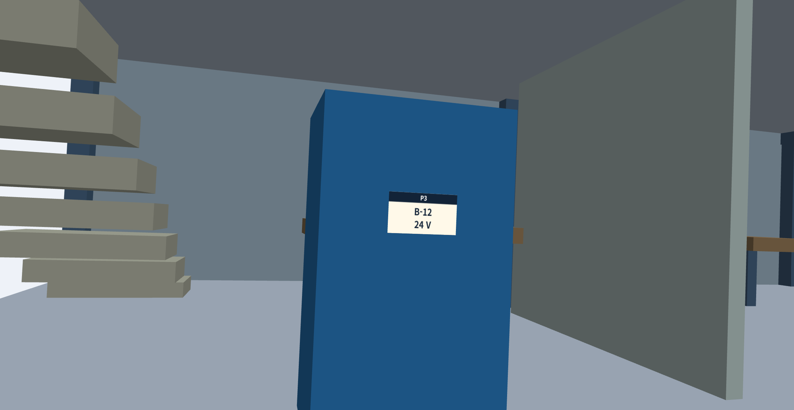
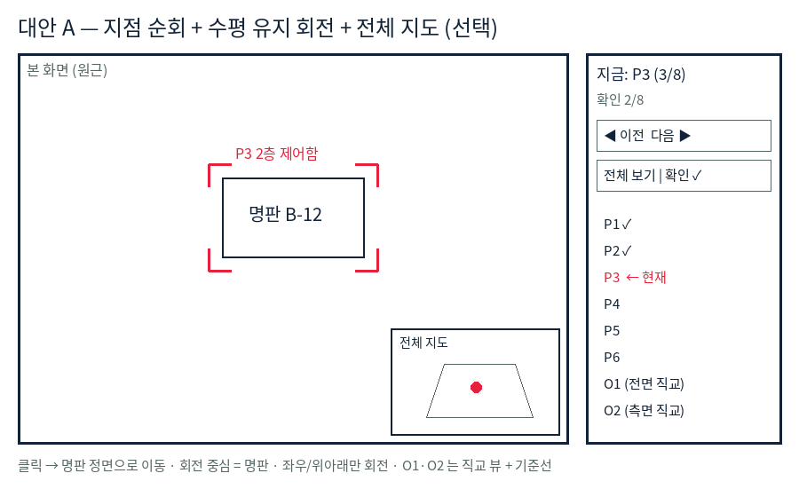
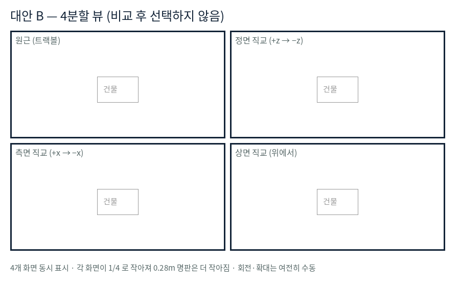
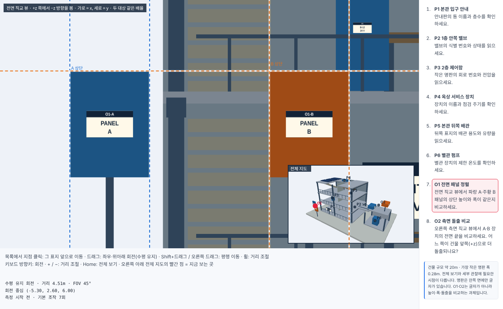
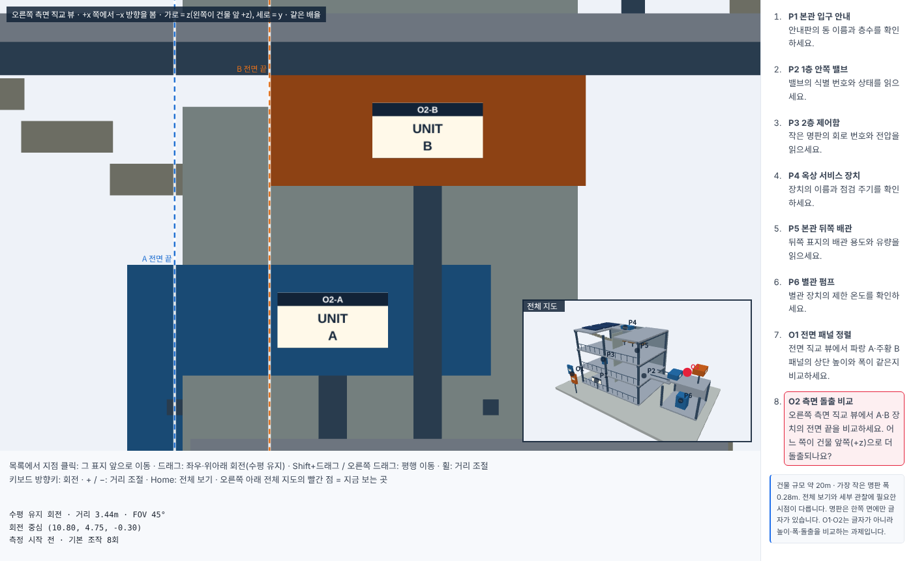
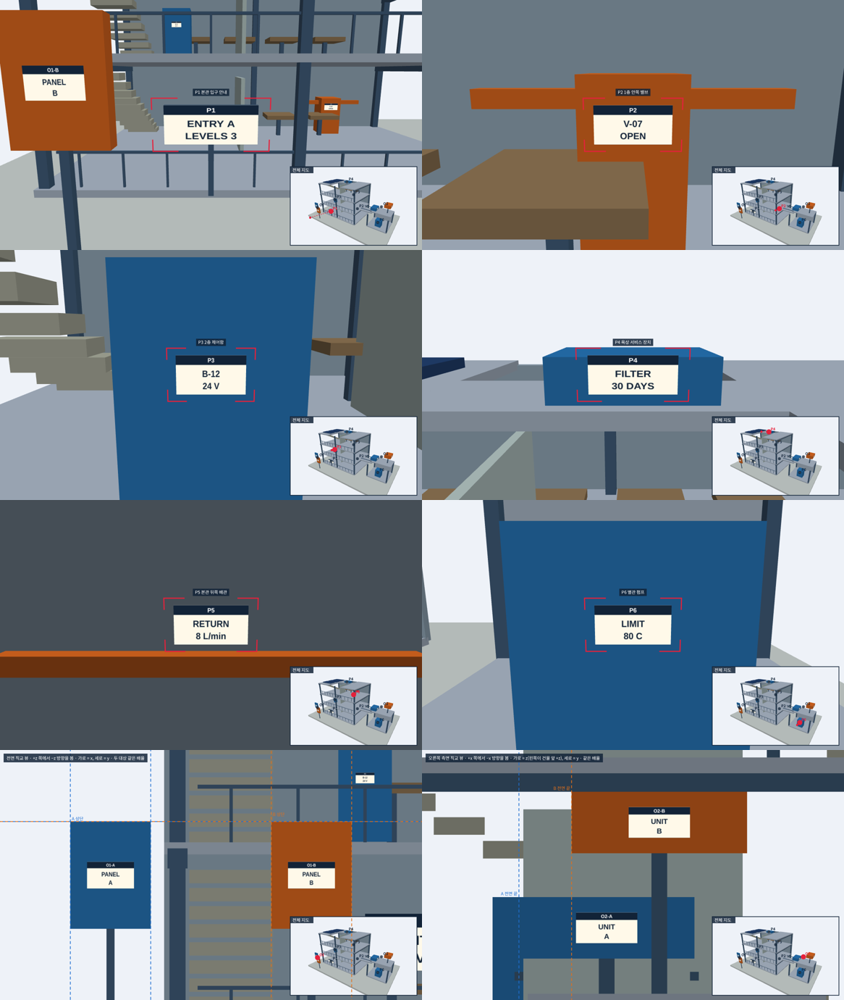
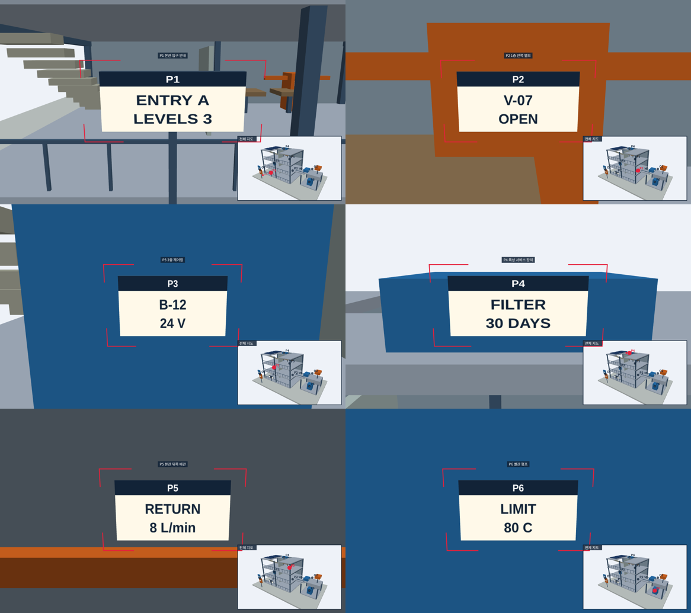

# 4주차 — 중요한 정보를 놓치지 않는 3D 관찰 인터페이스

- 이름: 김병찬
- 저장소: https://github.com/giwonBC/cg-2026-solar/tree/main/week4
- 실행: [기본 버전](https://giwonbc.github.io/cg-2026-solar/week4/baseline/index.html) · [개선 버전](https://giwonbc.github.io/cg-2026-solar/week4/improved/index.html)

## 1. 실행 주소와 조작법

| 버전 | 실행 주소 |
| --- | --- |
| 기본 버전 | https://giwonbc.github.io/cg-2026-solar/week4/baseline/ |
| 개선 버전 | https://giwonbc.github.io/cg-2026-solar/week4/improved/ |

**기본 버전** — 드래그: 트랙볼 회전 · Shift+드래그 / 오른쪽 드래그: 평행 이동 · 휠: 거리 조절 · 방향키: 회전 · Home: 전체 보기

**개선 버전**

| 조작 | 동작 |
| --- | --- |
| 오른쪽 목록에서 지점 클릭 (또는 ◀ 이전 / 다음 ▶) | 그 표지를 읽기 좋은 위치로 0.9초 동안 이동, 회전 중심이 그 표지로 바뀜 |
| 드래그 | 가로 = 좌우 회전, 세로 = 위아래 회전 (화면이 기울지 않음) |
| Shift+드래그 / 오른쪽 드래그 / 휠 | 평행 이동 / 거리 조절 (기본과 같음) |
| O1 · O2 클릭 | 전면 / 오른쪽 측면 **직교 뷰**로 전환, 비교할 모서리에 점선 기준선. 회전은 잠기고 드래그는 이동 |
| 확인 완료 ✓ | 지금 지점을 확인 목록에 체크. 남은 지점이 패널에 표시됨 |
| 전체 보기로 복귀 | 처음 시점으로 부드럽게 돌아감 |
| 오른쪽 아래 전체 지도 | 모든 지점 위치, 빨간 점 = 지금 보는 곳, 점선 = 카메라가 보는 방향 |


## 2. 기본 버전 관찰 결과

전체 보기에서 시작해 P1 → P6 → O1 → O2 순서로 관찰함. 시간과 조작 횟수는 화면 아래 측정값을 지점마다 기록함.

| 지점 | 결과 | 시간 | 조작 | 어려웠던 점 |
| --- | --- | --- | --- | --- |
| P1 본관 입구 안내 | 성공 | 5초 | 8회 |  |
| P2 1층 안쪽 밸브 | 성공 | 7초 | 20회 | 회전하다 화면이 기울어 다시 맞춤 |
| P3 2층 제어함 | 성공 | 7초 | 19회 | 회전 중 기울어짐, 확대 후 위치를 모름 |
| P4 옥상 서비스 장치 | 성공 | 10초 | 17회 | 회전하다 화면이 기울어 다시 맞춤  |
| P5 본관 뒤쪽 배관 | 성공 | 9초 | 18회 | 회전하다 화면이 기울어 다시 맞춤  |
| P6 별관 펌프 | 성공 | 7초 | 13회 |  |
| O1 전면 패널 정렬 | **판단 보류** | 6초 | 10회 | 원근 때문에 B 가 커 보여 크기가 같은지 알 수 없음 |
| O2 측면 돌출 비교 | 판단 결과 | 4초 | 8회 |  |
| **합계** | 6 성공 | **55초** | **113회** | |

가장 큰 문제는 시간보다 **조작 횟수**. P2·P3 는 7초 동안 약 20번(1초에 3번 가까이) 조작함. 원하는 곳을 찾기보다 화면을 원하는 각도로 맞추느라 짧은 드래그를 반복함.

### 불편 1 — 화면이 원치 않게 기울어진다


회전이 왼쪽 드래그 하나로 자유롭게 돌아가는 트랙볼이라, 손을 조금만 비스듬히 움직여도 화면이 옆으로 기울었음. 건물이 대각선으로 누워 층의 위아래가 헷갈리고 글자도 비스듬해짐. 다시 수평을 맞추느라 조작이 늘음.

### 불편 2 — 원근 화면에서는 O1 크기를 비교할 수 없다


패널 A·B 는 같은 크기(1.2 × 1.6 m)이지만, B 가 카메라 쪽으로 1.6 m 더 나와 있어 화면에서는 B 가 훨씬 크게 보임. 원근 투영은 가까운 것을 크게 그리므로, 깊이가 다른 두 물체의 높이·폭을 눈으로 비교할 수 없어 판단 보류로 남겼음.

### 불편 3 — 작은 명판을 확대하면 지금 어디인지 알 수 없다



P3 명판은 읽혔지만, 화면에 계단·칸막이·천장만 남아 이곳이 건물 몇 층 어디인지 알 수 없었음. 화면도 살짝 기울어 있음.

## 3. 누구를 위해 무엇을 개선할까

**사용자:** 3D 조작에 익숙하지 않은 점검자가 여섯 장치의 표지와 두 구조 비교를 적은 조작으로 빠짐없이 확인한다.

**목표 두 가지:** ① 조작 부담 줄이기 (반복 회전·확대 없애기) ② 위치 파악과 누락 방지

### 대안 비교





| | 대안 A: 지점 순회 + 수평 유지 회전 + 전체 지도 | 대안 B: 4분할 뷰 |
| --- | --- | --- |
| 불편 1 (기울어짐) |  회전을 좌우·위아래로 제한, 클릭하면 정면으로 이동 |  원근 화면은 여전히 수동 트랙볼 |
| 불편 2 (O1 비교) |  필요할 때 직교 뷰 + 기준선 |  정면·측면 직교가 항상 보임 |
| 불편 3 (위치 모름) |  전체 지도에 현재 위치 표시 |  원근 화면이 위치를 보여 주지만 작음 |
| 작은 명판 가독성 |  명판에 맞춰 거리 계산 |  화면이 1/4 로 작아져 0.28 m 명판이 더 안 보임 |
| 단점 | 자동 이동 중 길을 잃을 수 있음 → 전체 지도로 보완 | 입력이 어느 뷰에 적용되는지 헷갈림 |

**선택:** 대안 A. 제가 겪은 불편은 대부분 "원하는 곳에 화면을 맞추는 조작"에서 나왔고, 4분할은 이 조작을 줄여 주지 않으면서 작은 명판을 더 작게 만듬. 대신 4분할의 장점인 "전체 위치를 함께 보기"는 A 에 작은 전체 지도로 넣음.

**어떤 조작을 줄이고 어떤 정보를 유지하는가:** 찾아가기 위한 회전·확대·이동을 목록 클릭 한 번으로 줄임. 대신 실제 3D 표지를 직접 읽는 과정은 유지. 목록이나 화면에 답(표지 글자)을 따로 적지 않았고, 기준선도 선만 그을 뿐 "같다/다르다"를 알려 주지 않음.

### 수평 유지 회전 (불편 1)

트랙볼의 쿼터니언 대신 각도 두 개만 씁니다. 두 회전 모두 화면을 옆으로 눕히지 않으므로 건물 위쪽이 항상 화면 위쪽이다.

```js
// controls.js — yaw: 세계 +y 축 기준 좌우, pitch: 카메라 가로축 기준 위아래(범위 제한)
state.yaw   = drag.yaw   - dx * k;
state.pitch = drag.pitch - dy * k;
state.pitch = Math.max(PITCH_MIN, Math.min(PITCH_MAX, state.pitch));
const qy = [0, Math.sin(state.yaw/2), 0, Math.cos(state.yaw/2)];
const qx = [Math.sin(state.pitch/2), 0, 0, Math.cos(state.pitch/2)];
state.rotation = normalize(mul(qy, qx));   // viewer 가 쓰던 쿼터니언 형식은 그대로 유지
```

### 지점으로 이동할 때의 eye · target · up

```js
// student.js — poiView()
target:   명판 중심                       // 회전 중심도 명판으로 바뀐다
yaw:      명판의 yaw                       // 명판 앞면이 향하는 방향에서 바라본다
pitch:    -0.18                            // 약 10° 위 — 장치 윗면이 보여 맥락이 생긴다
distance: max(명판 높이 / 0.30, 명판 폭 / (0.60 · 화면비)) / (2 · tan(FOV/2))
up:       +y                               // 회전이 수평 유지이므로 항상 세계 위쪽
```

- eye 는 `target + 회전(0, 0, distance)`. 명판 앞쪽으로 distance 만큼, 약간 위에 있음.
- **거리와 FOV:** 시야 높이 = 2 · 거리 · tan(FOV/2) 입니다. 명판이 화면 높이의 30% 가 되도록 거리를 거꾸로 계산하므로, 큰 표지(P1, 폭 2 m)는 멀리(약 3.4 m), 작은 명판(P3, 폭 0.28 m)은 가까이(약 0.64 m) 갑니다. 같은 거리로 모든 표지를 보지 않고 대상 크기에 맞춰 거리를 정한 것.
- **회전 중심:** 전체 보기에서는 건물 중심, 지점을 고르면 그 명판. 그래서 도착 후 드래그하면 명판 주위를 돌아 주변 장치를 볼 수 있습니다.

### 이동 경로와 가림

```js
// student.js — step(): 0.9초, ease-in-out
S.distance = 보간된 거리 + sin(π·t) · 이동 거리 · 0.6;
```

멀리 이동할 때는 중간에 카메라가 잠깐 뒤로 물러나 건물 전체를 보여 줌. 건물 안을 뚫고 지나가는 느낌을 줄이기 위함.

### O1 · O2 직교 뷰 (불편 2)

| | 카메라 방향 | 화면 가로 | 기준선 |
| --- | --- | --- | --- |
| O1 | +z 에서 −z (yaw 0), up +y | x | 두 패널의 상단(y), 왼쪽·오른쪽 끝(x) |
| O2 | +x 에서 −x (yaw π/2), up +y | z (+z 가 화면 왼쪽) | 두 장치의 +z 쪽 전면 끝 |

```js
// student.js — orthoView(), mainCamera()
const half = 1.5 * Math.max(물체들 높이 / 2, 물체들 폭 / 2 / 화면비);   // 두 물체가 다 들어오게
{ orthographic: true, halfHeight: half, eye: target + 뒤쪽 · 60, near: .1, far: 200 }
```

- **같은 배율:** 두 물체를 한 화면, 한 직교 투영에 그리므로 세계 1 m 가 화면에서 같은 픽셀 수. 물체마다 따로 확대한 두 화면을 비교하는 방식은 쓰지 않음.
- **직교를 쓴 이유:** 직교 투영은 거리로 나누지 않으므로 앞에 있는 B 도 A 와 같은 크기로 그려짐. 그래서 상단 높이·폭·돌출을 직접 비교할 수 있음.
- **회전 잠금:** 직교 뷰에서 회전하면 축 정렬이 깨져 비교가 무의미해지므로 회전을 잠그고, 드래그는 이동으로 바꿈.
- **near 클리핑:** 직교 뷰의 눈은 같은 방향으로 60 m 뒤에 두어, 휠로 확대해도 앞쪽 물체가 near 면에 잘리지 않음.

### 위치 파악과 누락 방지 (불편 3)

- **전체 지도:** `drawView` 를 한 번 더 호출해 오른쪽 아래 영역에 고정된 전체 시점을 그리고, 그 위에 모든 지점과 현재 위치(빨간 점)·카메라 방향을 표시함.
- **현재 대상 표시:** 지금 보는 명판 둘레에 빨간 괄호와 "P3 2층 제어함" 이름표를 그려, 이 글자가 어느 장치의 정보인지 알 수 있게 함.
- **진행 상태:** 패널에 "지금 보는 곳 (3/8)", "확인 완료 n/8 · 남은 곳" 을 표시.
- **조작 횟수:** 새로 만든 버튼 클릭도 기본 조작과 같은 카운터(`S.actions++`)로 셈.

## 5. 개선 전후 비교

### 지점별 측정

| 지점 | 기본 | 개선 1차 | 수정 후 (최종) |
| --- | --- | --- | --- |
| P1 | 5초 / 8회 | 4초 / 10회 | 4초 / 13회 |
| P2 | 7초 / 20회 | 6초 / 25회 | 4초 / 18회 |
| P3 | 7초 / 19회 | 4초 / 19회 | 6초 / 22회 |
| P4 | 10초 / 17회 | 5초 / 19회 | 4초 / 12회 |
| P5 | 9초 / 18회 | 7초 / 15회 | 4초 / 12회 |
| P6 | 7초 / 13회 | 5초 / 21회 | 6초 / 22회 |
| O1 | 6초 / 10회 | 4초 / 17회 | 4초 / 8회 |
| O2 | 4초 / 8회 | 3초 / 12회 | 3초 / 10회 |

### 요약

| 비교 항목 | 기본 버전 | 개선 버전 (최종) | 해석 |
| --- | --- | --- | --- |
| 관찰 완료 수 | 6/8 + 보류 ✏️ | ✏️ /8 | ✏️ O1 이 보류 → 판단 가능으로 바뀌었는가 |
| 전체 관찰 시간 | 55초 | 35초 | 36% 감소. 찾아가는 시간이 줄었다 |
| 조작 부담 | 113회 | 117회 | 거의 같음. 아래 해석 참고 |
| 불편 1 기울어짐 | 있음 | 해결 | 수평 유지 회전 |
| 불편 2 O1 비교 | 판단 보류 | ✏️ 해결 / 부분 해결 | 직교 뷰 + 기준선 |
| 불편 3 위치 모름 | 있음 | 해결 | 전체 지도 + 현재 대상 표시 |
| 새로 생긴 불편 | — | 도착 후 휠로 거리를 미세 조정 → 수정 1 로 일부 해결 | |

**조작 횟수에 대한 해석:** 시간은 줄었지만 조작 횟수는 기본과 비슷했음. 찾아가는 조작은 목록 클릭 한 번으로 줄었지만, 도착한 뒤 휠로 거리를 세밀하게 조정하는 조작이 많았기 때문. 휠은 한 칸마다 1회로 세어지므로 적은 움직임도 큰 숫자가 된다. 그래서 조작 횟수만으로 "부담이 줄지 않았다"고 결론 내리지는 않았지만, "조작 횟수를 줄였다"고 주장할 수도 없음. 체감으로는 기울어짐을 바로잡는 조작이 사라져 훨씬 편했음.

### O1 · O2 개선 버전 화면



-**O1 판단:** 기준선을 보면 두 패널의 상단 높이는 같고 폭도 같다. 근거: 전면 직교 뷰에서 A·B 상단 점선이 한 줄로 겹치고, 양옆 세로 점선 사이 간격이 같다. 원근 화면에서 B가 커 보였던 것은 B가 카메라 쪽으로 1.6m 더 나와 있었기 때문.
- 원근 트랙볼에서는 B 가 커 보여 판단 보류였지만, 직교 뷰에서는 거리와 상관없이 같은 배율로 그려져 모서리를 직접 비교할 수 있었습니다.



-**O2 판단:** 화면 왼쪽이 건물 앞이므로, 전면 끝 점선이 더 왼쪽에 있는 A가 더 앞으로 돌출된다. 근거: A 전면 끝 점선이 B보다 왼쪽에 있음.


### 추가 수정 — 명판이 작아 휠을 많이 썼다

| | 수정 전 (개선 1차) | 수정 후 |
| --- | --- | --- |
| 관찰 | 도착하면 명판이 화면 높이의 16% → 글자가 작아 휠로 가까이 당김 | 명판이 화면 높이의 30% |
| 코드 | `SIGN_HEIGHT_RATIO = 0.16, SIGN_WIDTH_RATIO = 0.35` | `0.30, 0.60` |
| 결과 | 38초 / 138회 | 35초 / 117회 (P2 25 → 18회, P4 19 → 12회, P5 15 → 12회) |
| 잃은 것 | — | 명판 쪽으로 가까이 가서 주변 장치가 덜 보임. 위치는 전체 지도로 확인 |





### 측정의 한계

- **학습 효과:** 기본 → 개선 1차 → 수정 후 순서로 같은 사람이 측정했기 때문에, 뒤로 갈수록 지점 위치를 이미 알고 있어 빨라졌을 수 있음.
- **휠 횟수:** 휠은 한 칸마다 세어지고 기기(마우스·터치패드)에 따라 크게 달라지므로, 조작 횟수는 참고 값으로만 봄.
- **측정 방식:** 시간은 화면의 초 단위 표시를 보고 적어서 ±1초 정도의 오차가 있음. 측정자는 한 명.

## 6. AI 제안과 판단

이번 과제의 코드 수정은 AI(Claude)에게 기존 파일을 읽고 수정하도록 요청해 진행함. 관찰·측정·불편 정리와 최종 선택은 제가 했습니다.

| 제안 | 판단 | 이유 |
| --- | --- | --- |
| 대안 A(지점 순회 + 수평 회전) + 전체 지도 | **채택** | 제가 기록한 불편 3개(기울어짐·O1 비교·위치 모름)에 각각 대응 |
| 대안 B(4분할 뷰) | **거절** | 작은 명판이 더 작아지고, 기울어짐 문제를 해결하지 못함 |
| 휠 조작이 많을 때의 수정안 3가지: (가) 도착 거리를 더 가깝게 (나) 더 멀게 (다) "명판 크게 / 장치와 주변" 두 단계 버튼 | **(가)를 채택, (다) 거절** | 실제로 휠을 쓴 이유가 "글자가 작아서 가까이 당기기" 하나였으므로 가장 단순한 (가)로 충분하다고 판단. (다)는 버튼이 늘어나 화면이 복잡해짐 |
